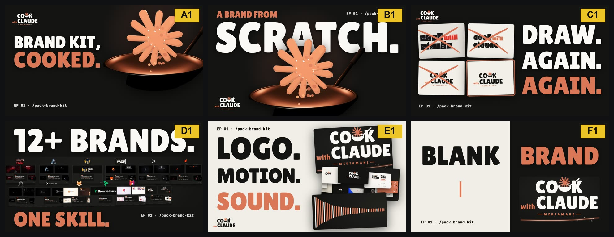
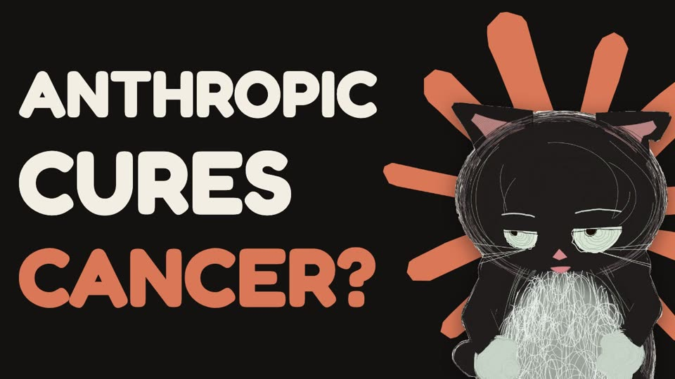
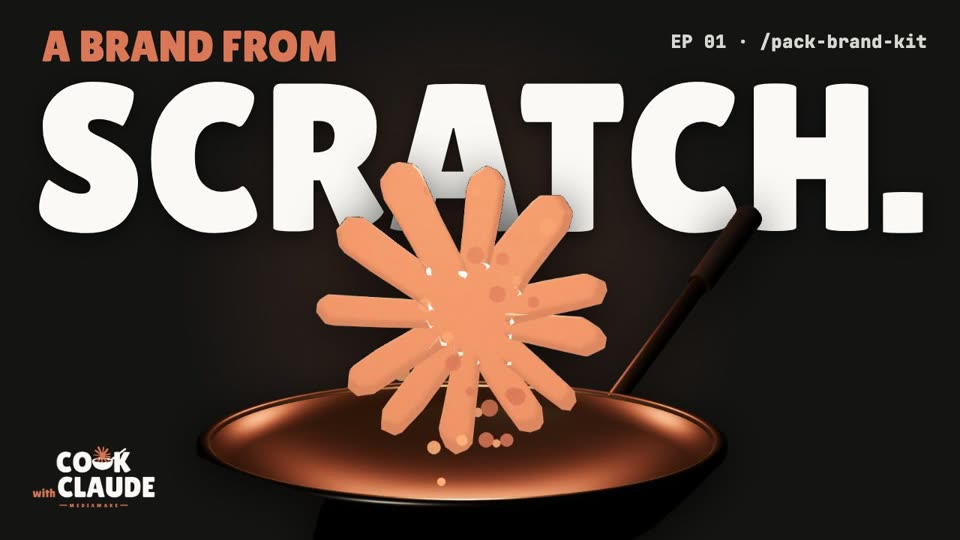
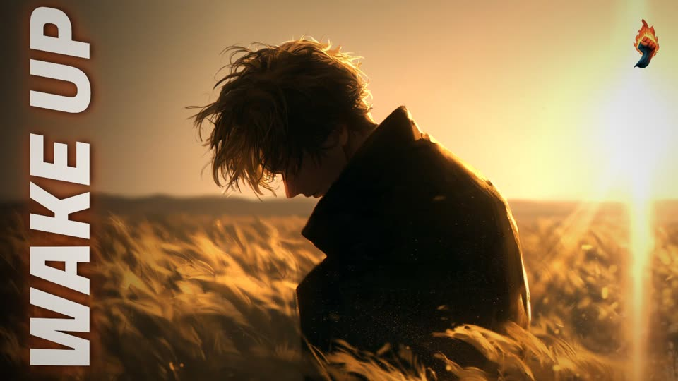
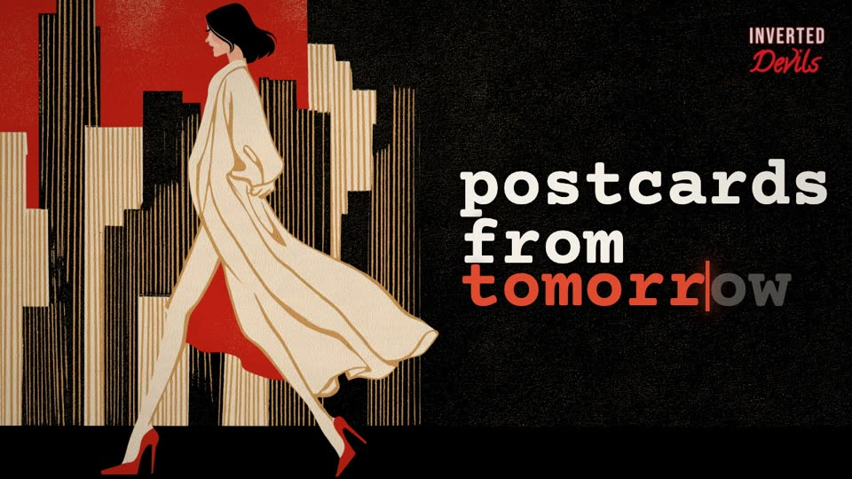

# Create thumbnail

Thumbnails people click, for any kind of channel: tech reviews, tutorials, documentaries, podcasts,
gaming, cooking, news, music and edits. Claude reads what the video is about, what kind of video it is
and whose channel it is on, works from what that kind's hit thumbnails share, and shows you a board of
genuinely different ideas before it makes anything final.

## How to use

1. Copy the install prompt and paste it into Claude. Install the Browse Hack MCP with it, and the
   Figcraft MCP if you want to edit the final yourself.
2. Say to Claude: **make a thumbnail for this video**, with its title and what it is about. Add your
   picture, a frame or a YouTube link, and the transcript if you have one.
3. Answer its few questions: which channel's logo goes on it, whether the title must be on it word for
   word, and the fonts you want.
4. Look at the board in the chat. Every thumbnail carries its ID at its top-right corner, so reply with
   the ones you like (**B and D**) and your notes by ID (**B2, but with the A1 font**).
5. Pick **one final**, or **three** for an A/B test in YouTube Studio (Test & Compare).
6. Want to change something yourself? Say **let me edit it**. The pick opens in FigCraft as layers,
   every headline as live text. Save with ⌘S, then say **bring it back**.

## What it uses

- [[mcp/browse-hack]] (recommended): frames from a YouTube link, and Midjourney concepts and outcrops
  in your Chrome. Without it, it works from your own pictures, Wikimedia Commons and page screenshots.
- [[mcp/figcraft]] (optional): rebuilds the pick as editable layers for your own final edit;
  [[use-figcraft]] has its rules. Without it, every change goes through Claude and a re-render.
- [[mcp/fal]] (optional, paid): generated concept art when Midjourney isn't wanted. It asks before
  spending anything.
- [[pack-brand-kit]]: a channel's thumbnail profile (its logos, fonts, colours, rules and mascot), when
  the channel has a kit.
- [[midjourney-outcrop]] and [[midjourney-style-reference]]: a picture widened to 16:9, or concepts in a
  look you name.
- [[write-youtube-metadata]]: a title for each thumbnail when you pick three for an A/B test.

## What the skill outputs

Your finals, 1280×720 JPEGs under YouTube's 2 MB limit, in your workspace's
`out/thumbnails/<job>/final/`, with the board and every variant beside them (`sheet.jpg`), and the
`.figcraft` file when you edited one by hand. Finals made with it:

