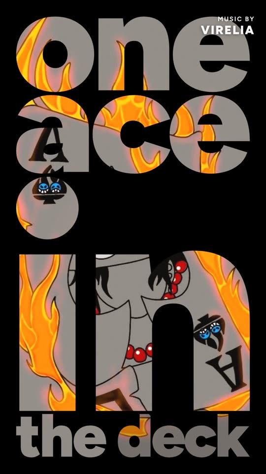
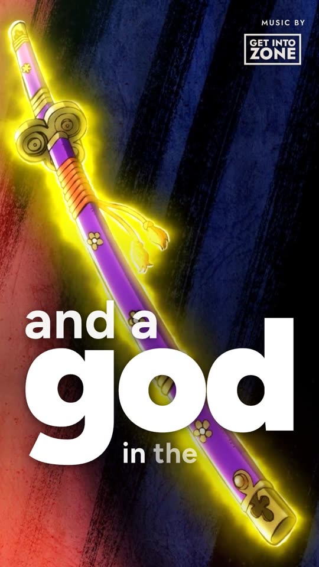
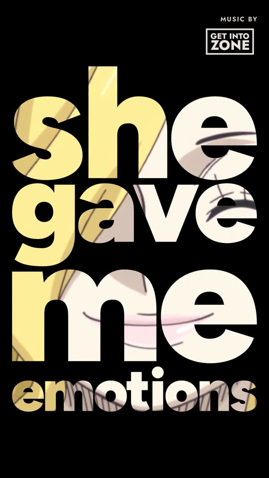
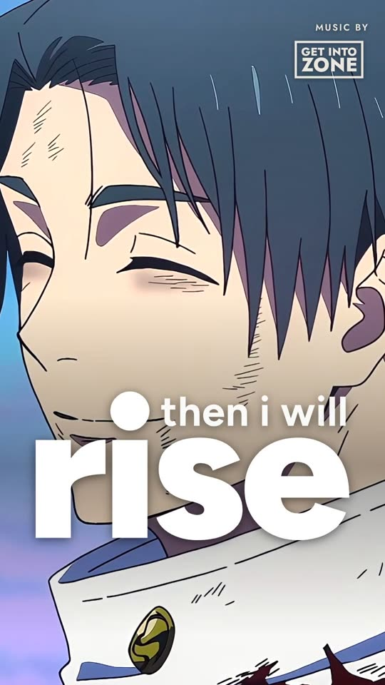
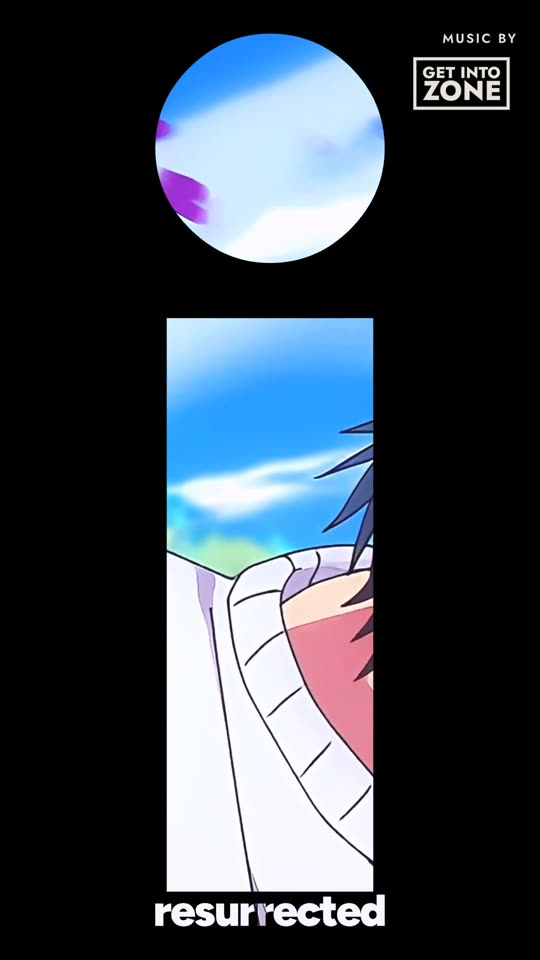
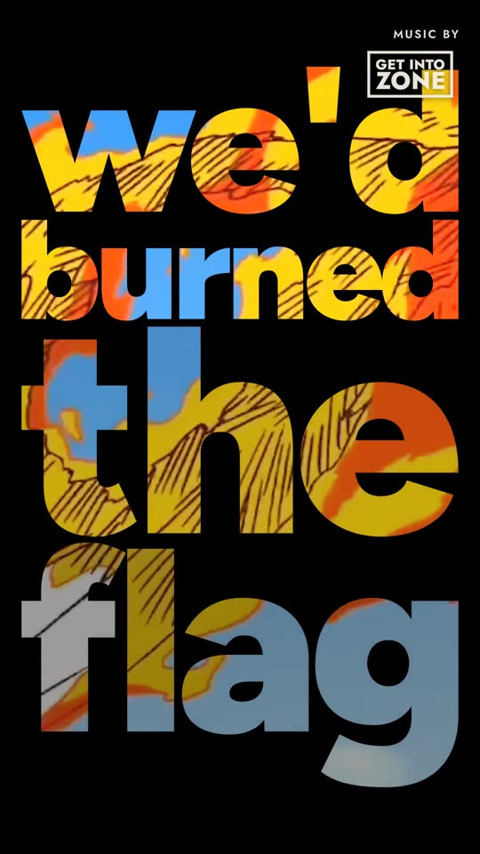

# Lyric shorts in bold words

Your song's best moments as vertical Shorts, in the stacked bold-words look. A short phrase per screen
fills the frame top to bottom, each word lighting up as it is sung. On the punch lines the footage plays
inside the letters, and on the drops the camera dives through a letter into the footage. Every other
line sits over the footage, its small words tucked in beside the big one.

## How to use

1. Give Claude your song (the file, or its YouTube link) and say: **make lyric shorts of this song in
   bold words**. Add your footage, or the character or anime to gather it for.
2. Claude looks for the song's words in your library first and asks before it transcribes (that is
   paid, so it shows the price).
3. Pick the stretches of the song from the ones it suggests: three by default, as many as you want.
4. Say the aspect (9:16, 3:4 or 4:5) and the watermark: your channel's logo, or a "Music by" credit.
5. Open the review links and leave notes on the videos. Claude fixes them and shows 10-second
   previews of what changed.
6. Say when they are right. Claude renders the masters and delivers them to your channel's folder.

## What it uses

- [[revise-video]]: the review loop for every Short.
- [[analyze-video]]: cuts your footage into shots, so each line can take the shot that says it.
- [[mcp/elevenlabs]] (required): the song's timed words, every word's start and end, from ElevenLabs
  Scribe. It shows the price first. Without it, bring a timed lyrics file.
- [[mcp/elevenlabs-connector]] (optional): the same words in the Claude web or phone app, where the
  ElevenLabs MCP can't run.
- [[mcp/browse-hack]] (optional): twixtor packs and Pinterest pictures straight into your media
  library. Without it they are downloaded with yt-dlp and gallery-dl.

## What the skill outputs

A Short for each stretch you picked: 15 to 45 seconds, 1080 × 1920 (or 3:4 and 4:5), made to loop, with
your watermark. Each is in your workspace's `out/<slug>/shorts/<id>/` with a sheet of its cuts, and goes
to your channel's folder once you approve it.

https://www.youtube.com/shorts/hAOCayjKKFQ

Made with it, on [anime sounds like](https://www.youtube.com/@anime-sounds-like) (27 Shorts):

- **[Luffy - King of The Pirates](https://www.youtube.com/shorts/hAOCayjKKFQ)** by Get into Zone: the
  one above.
- **[Ace - Ace in the Deck](https://www.youtube.com/shorts/TkVpkTX64KY)** by Virelia: another artist's
  song, credited with a "Music by" text mark.
- **[Nami - A One Piece Fan letter](https://www.youtube.com/shorts/iQUrnkFVcU8)** by Supermel.
- **[Maki - Let's Get Started](https://www.youtube.com/shorts/OlXinxrMphM)** by Get into Zone: a Jujutsu
  Kaisen song, cast from twixtor packs, manga animation and Pinterest art.
