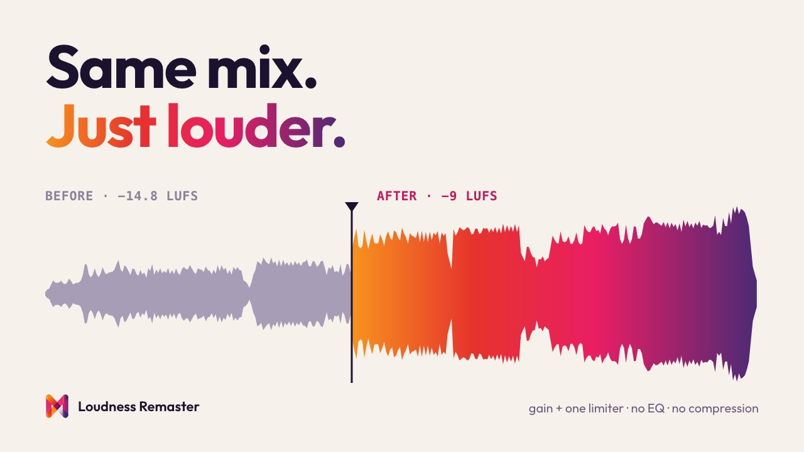

# Make Music Remaster Loudness

Most AI songs (Suno and the like) arrive already mixed, just quiet: around −15 LUFS, with headroom to
spare. This skill keeps the song's own mix exactly as it is and only makes it louder, in clean steps: a
gain-only copy, then −11, −10, −9 and −8 LUFS through one limiter and nothing else. No EQ, no
compression, no stem remix. You listen and choose how far.

## How to use

1. Copy the install prompt and paste it into Claude. Install the Soundcraft MCP too: it builds the
   louder versions.
2. Say to Claude: **remaster this song** and give it the song's folder or its mix. Or **make it louder
   for YouTube**, **give me loudness options for this track**.
3. Claude measures the song and builds the ladder, and tells you in plain words what each step costs:
   the build-up, the deep bass, the punch.
4. Open the Stem Player link it gives you. Every version plays from one playhead, so you hear them at
   the same moment as you switch. Mark the one you like as the final, and leave a note on any of them.
5. Claude copies your pick next to the mix as `<title> - final master (-9 LUFS).wav`.

Say **use REAPER** to build the ladder with REAPER's limiter instead, or **compare both engines** to get
every step from each, side by side.

## What it uses

- [[mcp/soundcraft]] (the default engine): makes the louder steps with SoundCraft's Maximizer, with no
  window, on your computer or in a cloud session. Without it, REAPER makes them.
- REAPER (optional): the other engine, with its ReaLimit. It has to be open on your computer.
- [[app/remaster-revision|Stem Player]]: where you compare the versions and pick the final.
- [[use-soundcraft]]: says how to install SoundCraft's command line.

## What the skill outputs

A ladder folder beside the song, `remaster/v1/`: one WAV for each step (24-bit, at the mix's own sample
rate, true peak −1 dBTP or lower), the engine's session, and `ladder.json`, which says what made each
file. Once you pick, the final master lands next to the song's mix and becomes the song's audio for
the video, the upload and the release.

WAKE UP's ladder, built by SoundCraft and measured by Claude. The build-up (loudness range) is what the
loudest steps give up:

| Version | Loudness | True peak | Build-up |
| --- | --- | --- | --- |
| The mix as it came | −14.8 LUFS | −3.3 dBTP | 6.1 LU |
| `WAKE UP - original -12 LUFS (level-matched).wav` (gain only) | −12.5 LUFS | −1.0 dBTP | 6.1 LU |
| `WAKE UP - original -11 LUFS (SoundCraft).wav` | −11.1 LUFS | −1.3 dBTP | 6.0 LU |
| `WAKE UP - original -10 LUFS (SoundCraft).wav` | −10.1 LUFS | −1.2 dBTP | 5.4 LU |
| `WAKE UP - original -9 LUFS (SoundCraft).wav` | −9.0 LUFS | −1.1 dBTP | 3.2 LU |
| `WAKE UP - original -8 LUFS (SoundCraft).wav` | −8.1 LUFS | −1.1 dBTP | 1.9 LU |
