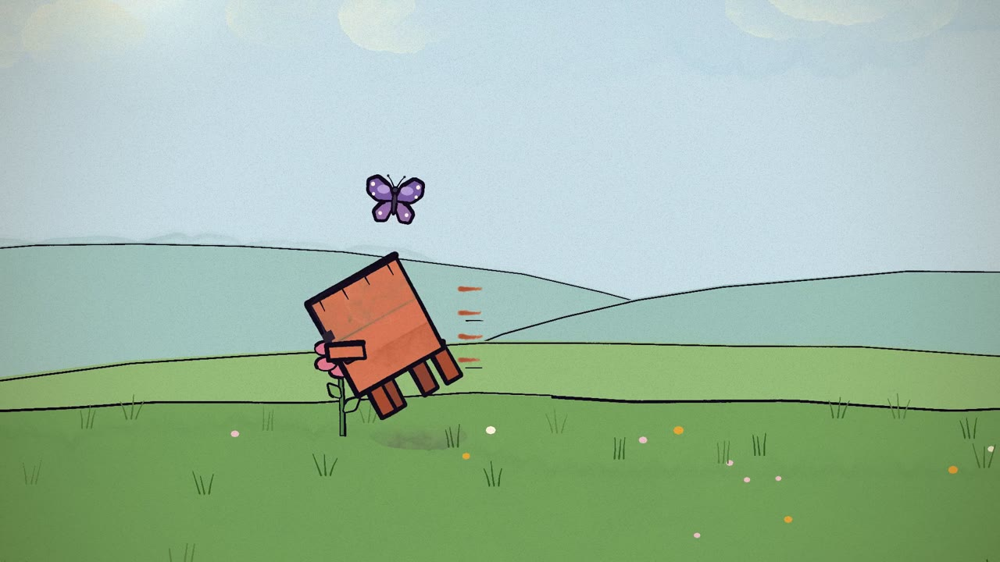
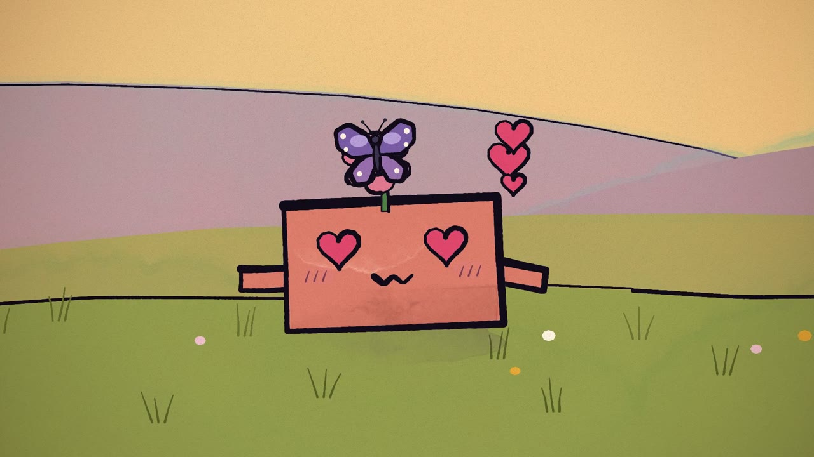

# Make painted cartoon

A short cartoon that looks painted by hand, from a sentence. Say what happens ("Clawd tries to catch a
butterfly") and Claude storyboards it, paints it shot by shot, looks at its own frames to fix the
timing and the acting, and shows you a preview. The look and the craft come from John Heibel's
[Claude Animation Base](https://github.com/JohnHeibel/ClaudeAnimationBase).

## How to use

1. Copy the install prompt and paste it into Claude.
2. Say what happens, as broadly or as exactly as you like: **make a 15-second cartoon of Clawd trying to
   catch a butterfly**, **animate Clawd baking a cake that keeps exploding, to this song**, **a painted
   cartoon of a little fox finding its way home, 20 seconds**.
3. Answer a few questions: how long, silent or to a song, who stars in it.
4. Read the storyboard it writes (every shot, and what you should understand when) and say what to change.
5. Watch the 10-second previews on the review screen and leave notes on any frame. The full video renders
   once you're happy.

## What it uses

- MediaMake's studio (`mm`): the kit runs inside it, so `mm painted` draws contact sheets, frame strips
  and close-up crops for Claude to check, and `mm render` makes the previews and the video.
- [[revise-video]]: the review screen where you watch each preview and leave notes, and where Claude
  checks every render for black or frozen frames before you see it.
- A song from your media library, when you want one: its beat drives every bounce, dance and hit.
- Chrome with a GPU paints fastest. Without one it still works, slowly.

## What the skill outputs

A project in your workspace, `projects/<name>/`: the storyboard, the shots as code you or Claude can keep
changing, and its renders in `out/<name>/`. You get 10-second previews to review, then the finished
video, 1920×1080 at 24 fps, silent or with your song.

From a 16-second test, "Clawd tries to catch a butterfly": the pounce that misses, and the ending, where
the butterfly lands on the flower that fell on Clawd's head.

