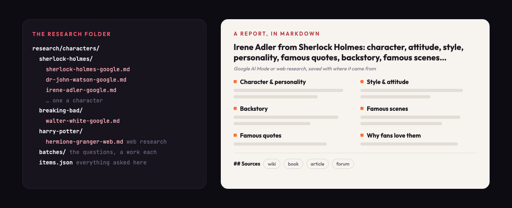

# Research character

Name a character, or a whole story, and get a report on each of its people: who they are, their
personality, attitude and style, their backstory, famous quotes and scenes, and why fans love them,
with the sources each came from. Any story: films, series, books, games, comics, plays, myths.

## How to use

1. Install it. For the best reports, have [[mcp/browse-hack]] in your Chrome as well; without it the
   skill still works (below).
2. Say to Claude what you want researched. Vague is fine:
   - **research the main characters of The Witcher**
   - **Walter White**
   - **research Sherlock Holmes and Pride and Prejudice, 6 characters each**
   - **which famous series are missing from my research folder?**
3. Check the cast it suggests (or say go). It asks one question a character, checks every answer and
   tells you what it saved.

Want other angles? Say so: "their voice and the way they speak", "their look and costume", "their
relationships". Add more characters to a work later and it skips the ones already done.

## What it uses

- [[mcp/browse-hack]] (recommended, the default way): asks Google's AI Mode in your own Chrome and saves
  each answer, with its sources, as Markdown. Every run uses it when it is there.
- Without Browse Hack, it falls back, in this order:
  - **A browser Claude can drive** (the Claude app's built-in browser, Claude in Chrome): the same Google
    AI Mode answers, read from the page.
  - **Claude's own web research** (web search, deep research), wherever there is no browser, a cloud
    session included: Claude reads several pages a character and writes the report from them, every
    fact from a page it read and every page listed as a source.
  
  Say "use web search" or "do deep research" to pick a way yourself.

## What the skill outputs

A research folder (`research/characters/` in your MediaMake workspace, or one you name) with a folder
for each work and a Markdown report for each character: `<name>-google.md` from Google's AI Mode,
`<name>-web.md` from web research. Each report is the question, how and when it was made, the answer
with its headings and lists, and a Sources list. The questions stay beside them, so the next run
carries on where this one stopped, on any computer.

