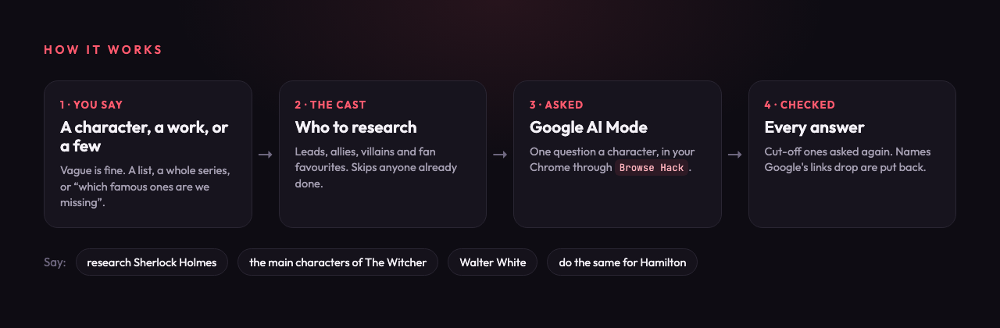

# Research character

Name a character, or a whole story, and get a report on each of its people: who they are, their
personality, attitude and style, their backstory, famous quotes and scenes, and why fans love them,
with the sources Google cites. Any story: films, series, books, games, comics, plays, myths.

## How to use

1. Install it, and [[mcp/browse-hack]] in your Chrome if you don't have it yet.
2. Say to Claude what you want researched. Vague is fine:
   - **research the main characters of The Witcher**
   - **Walter White**
   - **research Sherlock Holmes and Pride and Prejudice, 6 characters each**
   - **which famous series are missing from my research folder?**
3. Check the cast it suggests (or say go). It asks Google one question a character in your Chrome,
   checks every answer and tells you what it saved.

Want other angles? Say so: "their voice and the way they speak", "their look and costume", "their
relationships". Add more characters to a work later and it skips the ones already done.

## What it uses

- [[mcp/browse-hack]] (required): asks Google's AI Mode in your own Chrome and saves each answer, with
  its sources, as Markdown. Without it, the skill plans the cast and the questions and waits for a
  computer that has it.

## What the skill outputs

A research folder (`research/characters/` in your MediaMake workspace, or one you name) with a folder
for each work and a Markdown report for each character. Each report is the question, when and where it
was saved, Google's answer with its headings and lists, and a Sources list. The questions stay beside
them, so the next run carries on where this one stopped, on any computer.

