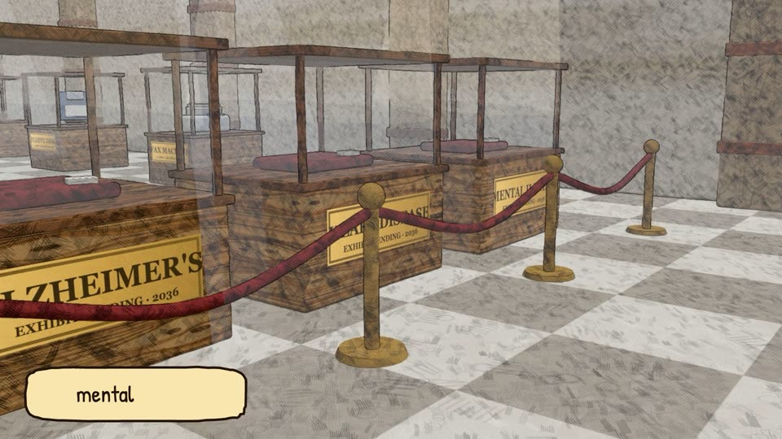
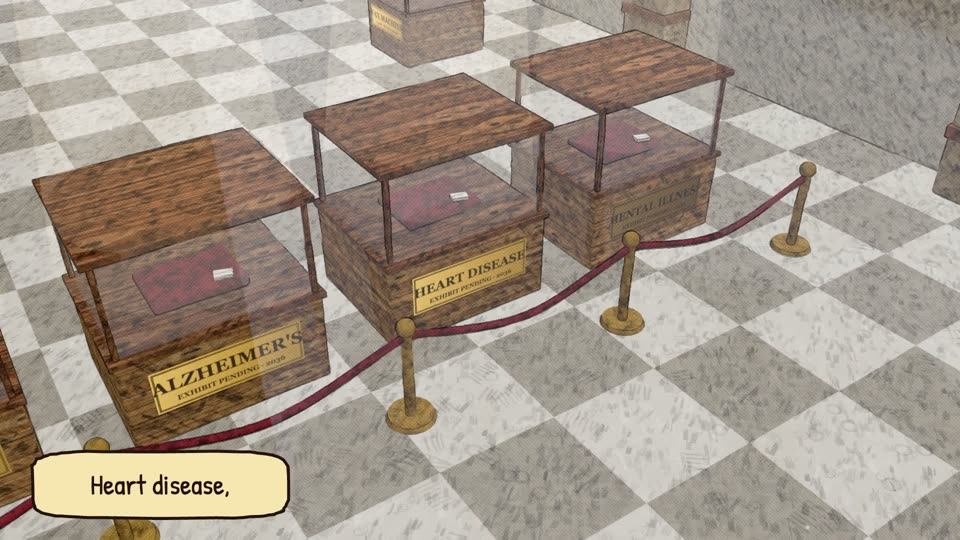
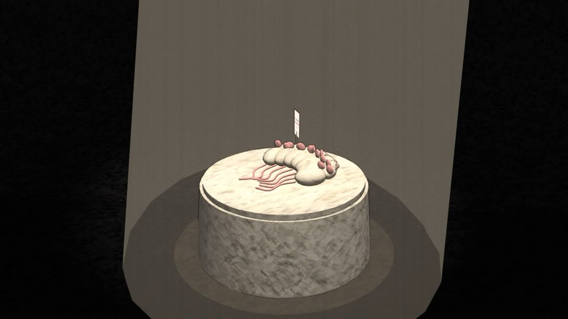
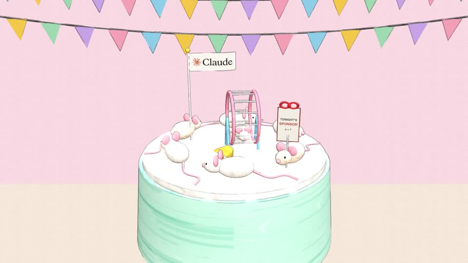

# Revise video

You watch, Claude fixes. After a render, Claude gives you a link to the Video Revision screen. Leave
your notes right on the frames, mark the revision ready, and Claude reads every note, fixes it in the
project, answers it and sends you the next preview. Previews are 10-second stretches around what
changed, so a round takes minutes, and the full video renders once, when you sign off.

## How to use

1. Copy the install prompt and paste it into Claude. It works with MediaMake's video skills: they hand
   their renders to it.
2. Open the link Claude gives you after a render, in Chrome, Edge or another Chromium browser. The first
   time, link your workspace's `out` folder as a source; every later link opens straight from it.
3. Leave your notes. Pause and say what should change on that frame, and draw on it if that helps
   (red fix, green add, yellow move). Select a stretch on the timeline for a note on a range, or press
   **G** for a note on the whole video.
4. Set the revision to **Ready for Claude**. Claude picks it up by itself while the session is open;
   otherwise say **rev-002 is ready**.
5. Watch the preview it sends back, and go again. When it's right, say **render it**: the master
   renders once.

Not rendered yet? Claude can give you a live link (`/video-revision?live=<project>`) that plays the
project straight from its code, so a first look costs no render at all.

## What it uses

- [[app/remotion-revision|Video Revision]] (required): the screen where you watch and leave notes. It
  reads the video from your computer; nothing is uploaded.
- MediaMake's studio on your computer (`mm render`, `mm preflight`, `mm wait-revision`): it renders the
  previews and the master, checks every render before you see it, and waits for your revision.
- [[app/remotion-editor|Remotion Editor]] (optional): **Tweak it yourself** opens a live project there
  for small changes you'd rather make by hand.
- The skills it reviews for: [[make-lyrics-video]], [[make-video-music-remix]],
  [[make-waveform-lyric-video]] and their variants.

## What the skill outputs

Every note answered. Beside the video, `out/<slug>/<slug>.revisions/` holds each revision
(`rev-001.json` and `rev-001.md`, with a still for every note on a frame), each note marked done with
what changed. With it come the preview of the fixes, checked before you see it, and the master once
you sign off. Two notes from a real review of a Doomcat episode, before and after:

