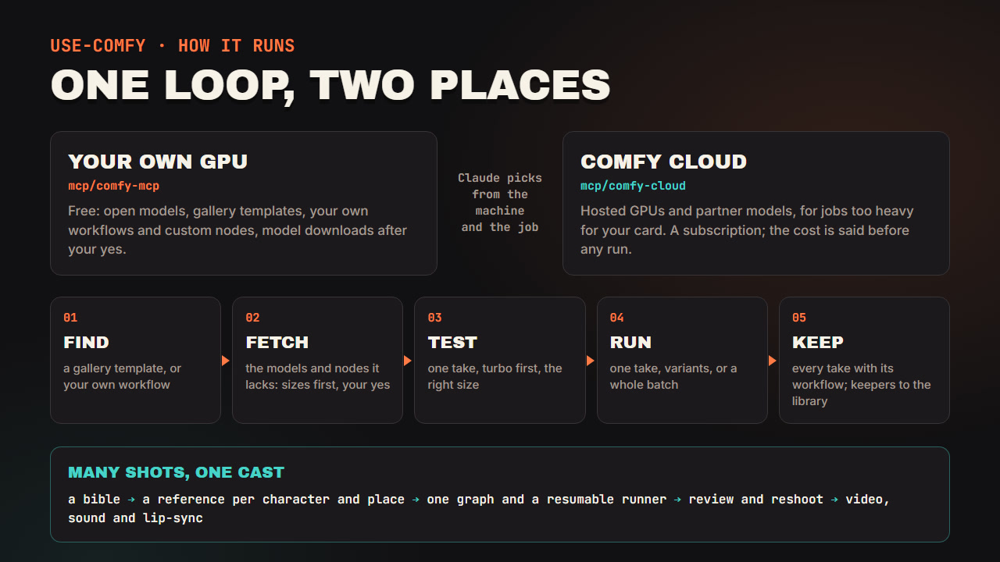
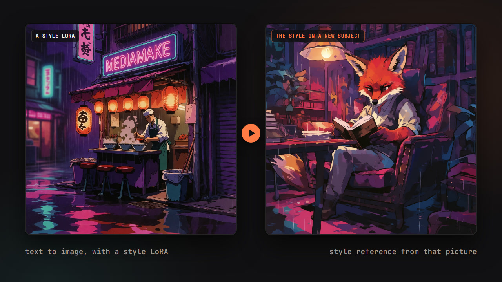
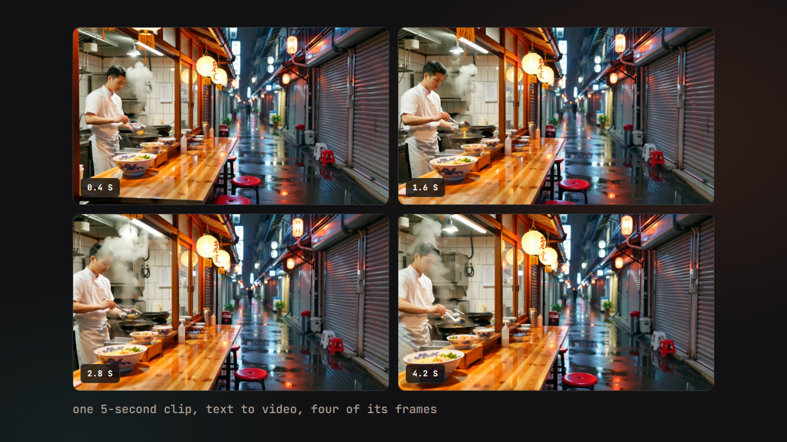
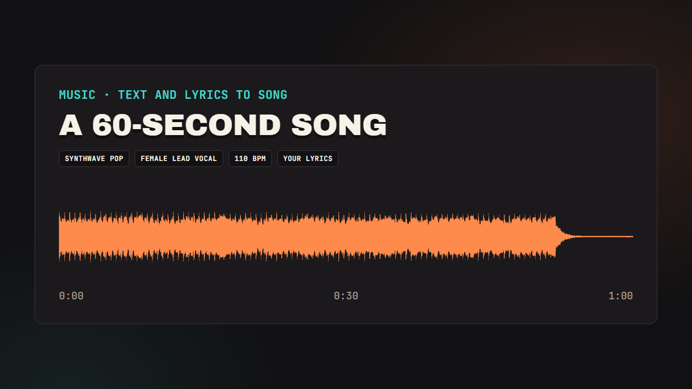
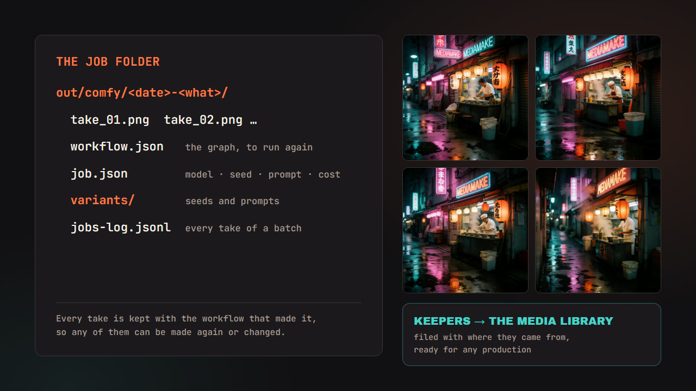

# Use Comfy

Ask Claude for a picture, a clip, a song or a 3D model, or hand it a ComfyUI workflow, and it makes it in
ComfyUI: on your own GPU when the job fits, on Comfy Cloud when it doesn't. It finds the template, fetches
what the workflow is missing once you say yes, tests one take before running many, and keeps every result
with the workflow that made it, so any of them can be made again or changed. Bigger jobs work too:
character sheets, a storyboard, a film's clips, with the same characters in every shot.

## How to use

1. Set up ComfyUI and its MCP once: tell Claude **set up mcp/comfy-mcp from MediaMake**. Add
   **mcp/comfy-cloud** too if you want Comfy's GPUs and partner models.
2. Say what you want, for example:
   - **make a poster background with Comfy: a misty pine forest at dawn, 16:9**
   - **turn this picture into a 5-second clip with Comfy**
   - **run this ComfyUI workflow on my GPU** (attach the file)
   - **upscale this 2x**, **remove the background**
   - **make character sheets and storyboard frames for this script with Comfy**
3. Claude says what a download or a cloud run costs before anything starts, and waits for your yes.
4. It shows you the takes. Keep the ones you like: they go to your media library, ready for any production.

## What it uses

- [[mcp/comfy-mcp]] (recommended): Comfy Org's server for the ComfyUI on your computer. It runs everything on
  your GPU, free with open models. Without it, everything runs on Comfy Cloud.
- [[mcp/comfy-cloud]] (optional): Comfy Org's hosted server, for partner models and jobs too heavy for your
  card. It needs a Comfy Cloud subscription. Without it, only what your GPU can run.
- The media library (`mm media`): where the keepers are filed and found again. Without it, they stay in the
  job folder.
- [[revise-image]]: a review set when there are several takes to choose from.

## What the skill outputs

A folder for each job in your workspace, `out/comfy/<date>-<what>/`: every take, the workflow that made it
(`workflow.json`), and what it took (`job.json`: the model, the seed, the prompt and any cost). A batch also
keeps a log of every take and a README of where everything is. The keepers are in your media library too.
All of these were made on a local GPU:

