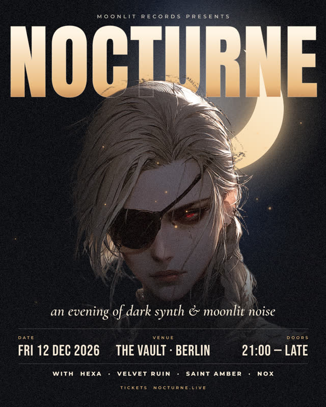
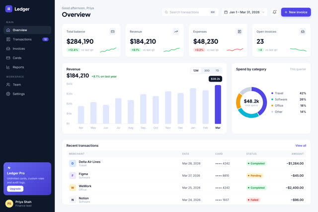
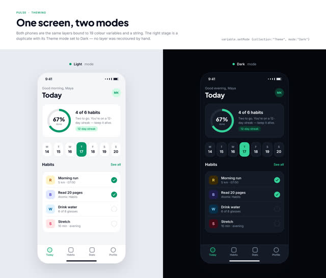
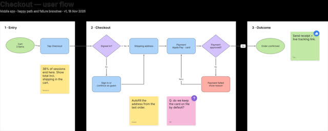
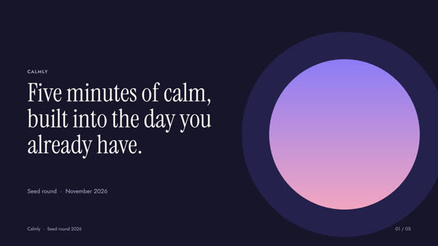
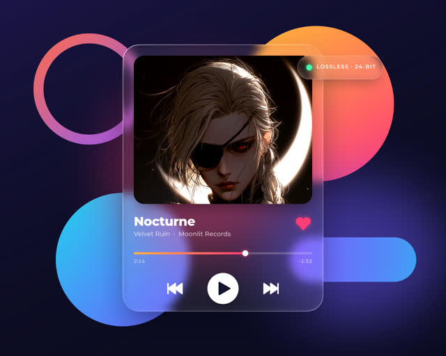

# Use Figcraft

Claude designs it. You edit it. Ask for a poster, a thumbnail, a banner, an app screen, a design system
or a deck: Claude builds it in Figcraft as real layers (frames, auto layout, components, live text),
checks it at the size it will be seen, and exports it. Then you open the file and change anything.

## How to use

1. Copy the install prompt and paste it into Claude. Install the Figcraft MCP too, and the FigCraft app
   for your own edits.
2. Say to Claude what to design and what it is for: **design a poster for my gig on 12 Dec**, **make a
   landing page for my app**, **build a design system with dark mode**, **prototype this sign-up flow**.
3. Look at what it shows you and say what to change.
4. Say **let me edit it myself**. It opens the file in FigCraft with its fonts installed. Change
   anything, save with ⌘S, then say **bring it back** and Claude exports your edit as a new version.

## What it uses

- [[mcp/figcraft]] (required): Claude builds, checks and exports the design through it. Its command
  line, `figcraft-cli`, does the same with scripts.

## What the skill outputs

A `.figcraft` file you can open and change, and its exports: PNG, JPG, WebP, SVG, PDF, Android XML or
.fig. Nineteen recipes are its starting points. Here is what some of them make:

