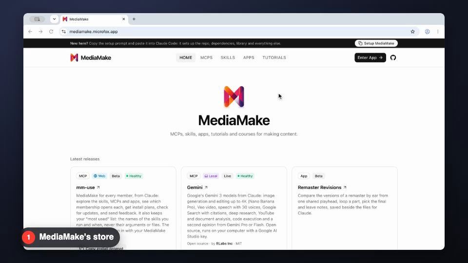
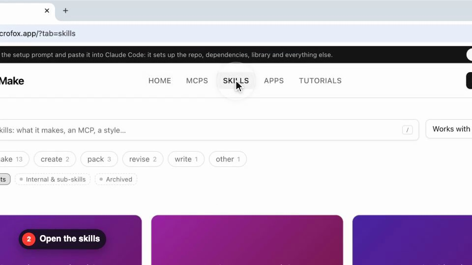
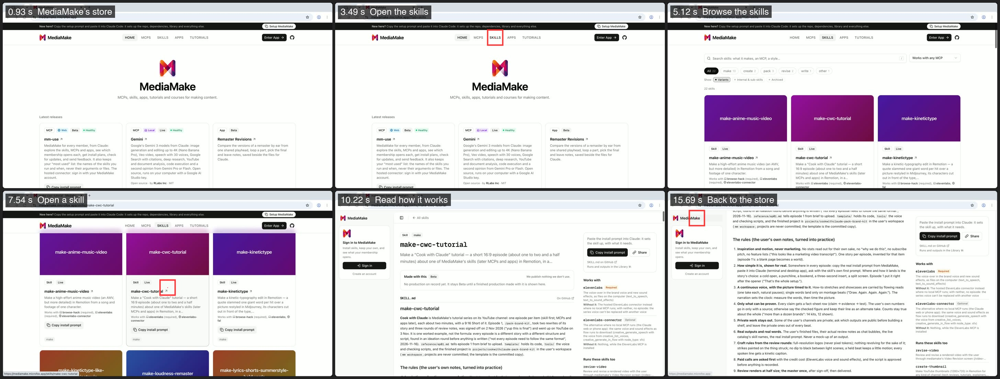

# Use Mac Recorder

Record your Mac's screen, one window or a region, for a product demo, a tutorial or a bug repro. You
get the take and an edit of it that zooms on every click, speeds up the waits and captions each step.

## How to use

1. Copy the install prompt and paste it into Claude. It installs the Mac Recorder MCP too.
2. Turn on **Screen Recording** for the app Claude runs in (System Settings › Privacy & Security ›
   Screen & System Audio Recording), then quit and reopen it.
3. Say to Claude: **record a demo of** your app or site (or **record a bug repro**, **record this
   window**).
4. Agree the steps it plans. When it says "recording", do them yourself, or let Claude drive a clean
   Chrome window on its own.
5. Watch the 10-second preview of the auto-zoom edit and say what to change. The full edit renders
   once you sign it off.

Nothing records until you say yes, and every take is kept: a new take gets a new name.

## What it uses

- [[mcp/mac-recorder]] (required): records the screen and logs the cursor, every click and the steps.
  Without it, macOS's own screen recording works by hand, with no log and so no auto-zoom.
- [[app/studio]]: plays the edit plan in Remotion and renders the previews and the final edit.
- [[revise-video]]: the review of the edit, comment by comment.

## What the skill outputs

The take, in `out/recordings/<name>/` of your MediaMake workspace: the video (H.264 at the screen's
Retina resolution), its events log (the cursor path, every click and the named steps, in the video's
own pixels and seconds) and a poster frame. Then a check sheet with a frame at each click, and the
edit: the head and tail trimmed, the waits sped up 4×, the zoom on each click, a smooth drawn cursor
and a caption for each step.

