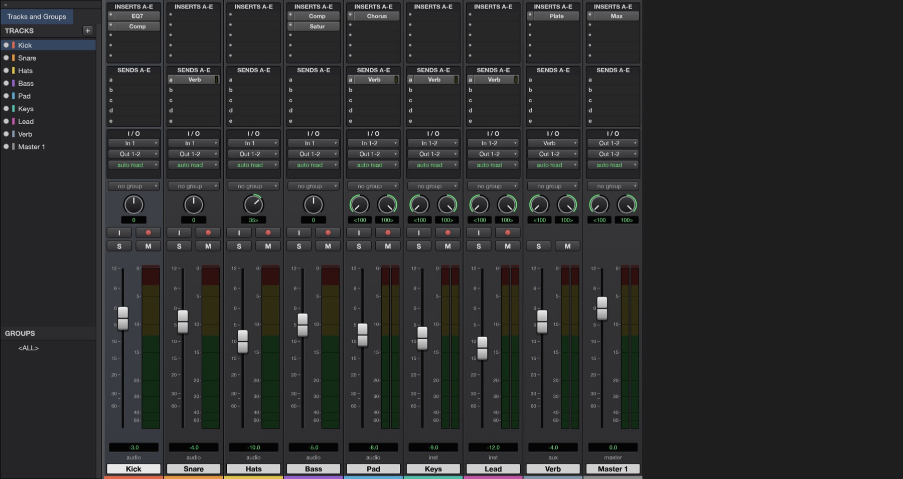

# Use Soundcraft

Claude works the desk. You listen and decide. Hand it a folder of stems or a finished song and say what
you want: a mix with the vocal up, a master at −9 LUFS, a 30-second teaser, a shorter cut. Claude builds
it in SoundCraft as a real session (tracks, buses, plugins, sends, automation), measures each change
since it can't hear, and gives you the file. Then you open the session and change anything by hand.

## How to use

1. Copy the install prompt and paste it into Claude. Install the Soundcraft MCP too, and the SoundCraft
   app for your own mixing and for listening.
2. Say to Claude what you have and what you want: **mix these stems and bring the vocal forward**,
   **master this to −9 LUFS, true peak under −1**, **give me loudness options**, **cut a 30 second teaser
   from the chorus**, **take the second verse out**, **pitch it up two semitones**, **convert these to
   44.1 kHz FLAC**.
3. Listen to what it gives you and say what to change. It tells you what it measured before and after,
   never how it sounds: that part is yours.
4. Say **let me mix it myself**. It opens the session in SoundCraft. Move anything, save with ⌘S, then
   say **bring it back** and Claude bounces your version as a new file.

## What it uses

- [[mcp/soundcraft]] (required): Claude builds, changes and bounces the session through it. Its command
  line, `soundcraft-cli`, does the same with step lists.

## What the skill outputs

A `.scraft` session you can open and change, and its bounces: the mix or its stems as WAV, AIFF or
FLAC, with the loudness, peaks and balance measured. Also MIDI files, MusicXML and a printable score
from MIDI parts. A session built this way opens in SoundCraft's Mix window like this:

