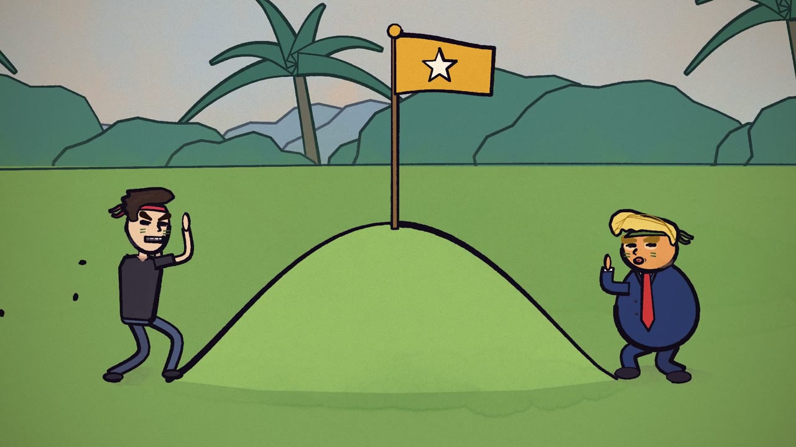
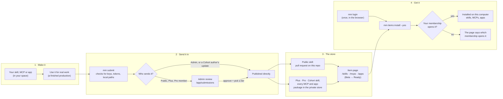

# MediaMake

**Skills, MCPs and apps that let Claude make content with you:** videos, Shorts, thumbnails, cartoons,
music and everything around them. Every one of them was used to make something real before it was
published. Here is some of what was made with it.

<table>
  <tr>
    <td width="25%" align="center" valign="top">
      <a href="https://www.youtube.com/shorts/TQsfMIO5mhM"></a>
      <br><b>Screaming to Win</b><br><sub>Kinetic type Short · <a href=".agents/skills/make-kinetictype-buildup-punch">make-kinetictype-buildup-punch</a></sub>
    </td>
    <td width="25%" align="center" valign="top">
      <a href="https://www.youtube.com/shorts/hZ-Z--6i3kw"></a>
      <br><b>Someone Took</b><br><sub>Kinetic type Short · <a href=".agents/skills/make-kinetictype-like-screamingtowin">make-kinetictype-like-screamingtowin</a></sub>
    </td>
    <td width="25%" align="center" valign="top">
      <a href=".agents/skills/make-painted-cartoon/shots/clawd-and-the-butterfly.mp4"></a>
      <br><b>Clawd and the butterfly</b><br><sub>Painted cartoon · <a href=".agents/skills/make-painted-cartoon">make-painted-cartoon</a></sub>
    </td>
    <td width="25%" align="center" valign="top">
      <a href=".agents/skills/make-painted-cartoon/shots/capture-the-flag.mp4"></a>
      <br><b>Capture the Flag</b><br><sub>Painted cartoon · <a href=".agents/skills/make-painted-cartoon">make-painted-cartoon</a></sub>
    </td>
  </tr>
  <tr>
    <td width="25%" align="center" valign="top">
      <a href="https://www.youtube.com/watch?v=7C88BcfQJoM"></a>
      <br><b>Cook with Claude, ep. 1</b><br><sub>Thumbnail · <a href=".agents/skills/create-thumbnail">create-thumbnail</a></sub>
    </td>
    <td width="25%" align="center" valign="top">
      <a href=".agents/skills/create-thumbnail"></a>
      <br><b>Doomcat, ep. 3</b><br><sub>Thumbnail · <a href=".agents/skills/create-thumbnail">create-thumbnail</a></sub>
    </td>
    <td width="25%" align="center" valign="top">
      <a href=".agents/skills/create-thumbnail"></a>
      <br><b>WAKE UP</b><br><sub>Thumbnail · <a href=".agents/skills/create-thumbnail">create-thumbnail</a></sub>
    </td>
    <td width="25%" align="center" valign="top">
      <a href=".agents/skills/create-thumbnail"></a>
      <br><b>Postcards from Tomorrow</b><br><sub>Thumbnail · <a href=".agents/skills/create-thumbnail">create-thumbnail</a></sub>
    </td>
  </tr>
</table>

Browse everything at [mediamake.microfox.app](https://mediamake.microfox.app). Each item has one page:
`/skills/<name>`, `/mcps/<name>` or `/apps/<name>` (for example
[/skills/create-thumbnail](https://mediamake.microfox.app/skills/create-thumbnail)).

## The rule

**We publish nothing we don't use.** A skill, MCP or app goes into the store only after it was used for
real work, and it names that work when it is sent in. Every item starts as **Beta**. An admin marks it
**Ready** once a finished production proves it, and its page shows that production under
"Made with this".

## How it works

There are two sides: **sending an item in** (submit, review, release) and **getting items** (sign in
once, and your membership decides what installs).



### Sending an item in

1. **Make it in your space.** A new skill is started with the `mm-new-item` skill, in your own private
   space (a GitHub repo of yours), never by hand in this repo.
2. **Use it.** Make something real with it: a video, a thumbnail, a song.
3. **Submit it.** Ask Claude to "make this public" (the `mm-submit-to-store` skill), or run
   `mm submit <name>`. It checks the files for keys, tokens and paths on your computer, then
   `mm submit <name> --yes --made="<the production>"` sends it. Cohort members and admins may leave
   out `--made`.
4. **Review.** An admin reads it on `/app/submissions`, picks the lowest membership that opens it
   (Public, Plus, Pro or Cohort) and approves, asks for changes or declines. An admin's own item, and an
   update a Cohort author sends for an item already in the store, skip the review.
5. **Release.** A Public skill becomes a pull request on this repo. Everything else (a Plus, Pro or
   Cohort skill, and every MCP and app) is released as a package from the private store repo. Its
   README becomes its store listing.

Getting an item accepted earns you a membership for 3 months (a Public or Plus item earns Plus, a Pro
item earns Pro). Contributing again renews it.

### Getting items

Access follows one ladder: **Public → Plus → Pro → Cohort → Admin**. Each membership opens everything
below it. There are no codes to copy and no prompts to paste.

1. `mm login` signs this computer in, once. Your browser opens, you click **Allow**, and the computer's
   key stays in its keychain.
2. `mm items` shows your account, your membership, and each MCP and app it opens (installed, behind or
   missing).
3. `mm items install --yes` installs or updates all of them. `mm items install <id> --yes` installs one
   (for example `mcp/browse-hack`). New MCPs are added to Claude Code for every project.

Public skills need no install: they come with this repo (`.agents/skills/`, linked from
`.claude/skills/`), so they load as soon as you open it in Claude Code. Skills your team shares come
through your project's space (`mm space join <project>`, then `mm space sync`).

## Set up MediaMake

You need **git**, a **GitHub sign-in** (`gh auth login`), **Node 22.6 or newer**, **uv** and
**ffmpeg**. The easiest way is to open Claude Code anywhere and say **"set up MediaMake"**: the
`setup-mediamake` skill installs and checks everything, and is safe to run again.

Or do it yourself:

```bash
gh repo clone microfox-ai/mediamake ~/mediamake
cd ~/mediamake
npm ci                       # installs exactly what the lockfile says
npm run mm -- link           # puts the `mm` command on your PATH
mm migrate --yes             # sets up your workspace in ~/MediaMake
mm doctor --fix              # checks the machine and fixes what it can
mm login                     # sign in to MediaMake (click Allow in the browser)
mm items install --yes       # install what your membership opens
```

Then open the folder in Claude Code and ask for something, like "make a thumbnail for this video".

**Day to day**

| Command | What it does |
| --- | --- |
| `mm help` | Lists every command |
| `mm doctor` | Checks Node, uv, ffmpeg, dependencies, builds, the render browser, git, your workspace and keys (`--fix` repairs what it can) |
| `mm update` | Brings this checkout up to GitHub, reinstalls dependencies when they changed, then runs `mm doctor`. Edits you made on `main` stop it; `mm update --yes` keeps them on a `local/<date>` branch first |
| `mm workspace` | Shows where your projects, renders and brand kits live (`~/MediaMake`, outside the checkout) |
| `mm preview` | Opens Remotion Studio |
| `mm render <slug> --preview` | Renders a 10-second preview on this computer |
| `mm cloud` | Sets up a Claude Code cloud session to build and render a project there |

Your own work (projects, renders, brand kits) lives in your workspace, not in this checkout, so
`main` always stays a clean copy of GitHub.

## What's in the repo

```
apps/
  mediamake/      The website and app: the store, item pages, spaces, library, reviews, hosted MCPs
  studio/         The Remotion workspace where every video is made (the `mm` command)
packages/
  remotion/       @microfox/remotion: JSON → Remotion components
  datamotion/     @microfox/datamotion: data-driven component configs
  mediamake-mcp/  The MediaMake MCP server
tools/            The scripts behind `mm` (items, submit, login, skills, guard rails)
.agents/skills/   Every public skill (linked from .claude/skills)
install.md        What Claude follows to install an item on a computer
```

To run the website locally: `npm run build --workspace=@microfox/remotion`, then
`cd apps/mediamake && npm run dev` (its settings go in `apps/mediamake/.env.local`; see
[apps/mediamake/README.md](apps/mediamake/README.md)).

## More docs

- [apps/studio/README.md](apps/studio/README.md): making videos with `mm`
- [Store submissions](apps/mediamake/docs/submissions.md) and [catalog releases](apps/mediamake/docs/catalog-releases.md)
- [Spaces](apps/mediamake/docs/private-spaces.md), the [Cloud Library](apps/mediamake/docs/library.md) and [cloud and device runs](apps/mediamake/docs/cloud-device-runs.md)
- [Item READMEs](apps/mediamake/docs/item-readme.md): how a store listing is written
- [What MediaMake knows about you](apps/mediamake/docs/usage.md)
- Related: the [Browse Hack extension and its MCP](https://github.com/microfox-ai/extensions)

## License

MIT for this repository ([LICENSE](LICENSE)). MediaMake is built on [Remotion](https://www.remotion.dev),
which needs a company license for some commercial use; see Remotion's licensing terms.
